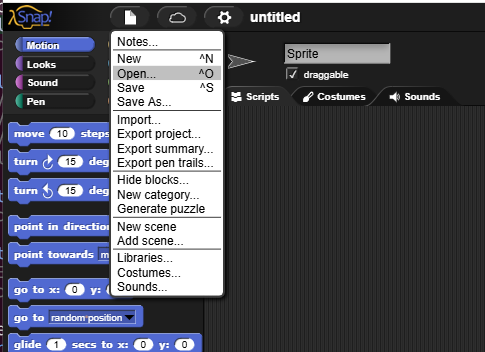
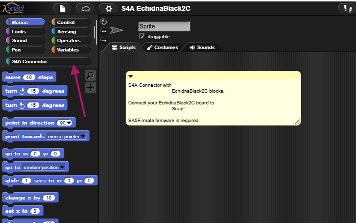
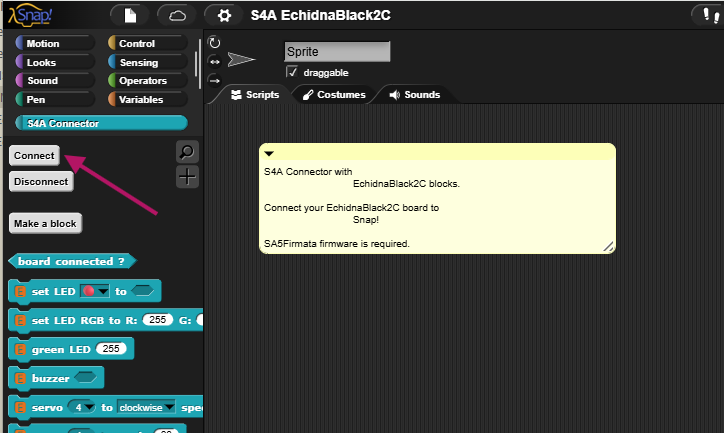

# S4A EchidnaBlack2C para Snap!

Este repositorio contiene un proyecto o biblioteca de Snap! que añade una categoría de bloques personalizada, **`S4A Connector`**, para la placa **EchidnaBlack2C**.

La biblioteca está diseñada para conectar Snap! con la placa mediante **StandardFirmata** y ofrecer:

- bloques genéricos de entrada y salida de la placa
- bloques específicos para el hardware de la EchidnaBlack2C

Snap! es un lenguaje de programación visual desarrollado por la Universidad de California en Berkeley:
<https://snap.berkeley.edu/>

Manual oficial de Snap!:
<https://snap.berkeley.edu/snap/help/SnapManual.pdf>

Sitio web del proyecto Echidna:
<https://echidna.es>

Documentación sobre Snap! en Echidna:
<https://echidna.es/ecosistema/snap/>

## Contenido del repositorio

- `S4A-EchidnaBlack2C.xml`: biblioteca o proyecto principal de Snap! con los bloques personalizados.
- `Test-EchidnaBlocks-Snap.xml`: proyecto de ejemplo y prueba que utiliza los bloques disponibles.

## Qué añade esta biblioteca

El proyecto XML define una paleta personalizada, **`S4A Connector`**, con bloques para:

- estado de la conexión (`board connected?`)
- entrada y salida digitales
- lectura analógica
- salida PWM
- control de servos
- operaciones de lectura, escritura y envío por I2C
- operaciones de tono, salida de pulsos, entrada de pulsos y sensores de tipo ping
- bloques auxiliares para Nunchuk y DHT11

También incluye bloques de más alto nivel adaptados a la placa **EchidnaBlack2C**, como:

- control de los LED integrados y del LED RGB
- control del zumbador
- salidas para servos en pines predefinidos
- botones de la placa
- comprobaciones de entrada y contacto MkMk
- lectura del joystick
- lectura del acelerómetro
- lectura del sensor de luz
- lectura de la temperatura
- lectura del micrófono
- lectura de entradas analógicas genéricas en los pines compatibles

## Requisitos

Para usar esta biblioteca necesitas:

- una versión de Snap! compatible con la importación o apertura de archivos XML de proyectos
- Google Chrome o Chromium, para que Snap! pueda acceder a la placa mediante USB
- una placa **EchidnaBlack2C** con el firmware **StandardFirmata** cargado.
- acceso al módulo conector `s4aConn` al que hace referencia el proyecto

La EchidnaBlack2C ya trae cargado de fábrica el firmware **StandardFirmata**, por lo que normalmente no necesitas instalarlo. Si lo has sustituido por otro programa, puedes descargar el [firmware StandardFirmata para la EchidnaBlack2C](https://github.com/EchidnaEducacion/EchidnaBlack2C_StdFirm) desde el repositorio de Echidna Educación y volver a cargarlo en la placa.

El [entorno original de Snap!](https://snap.berkeley.edu/snap/snap.html) cumple todos los requisitos indicados para el entorno y es el que se recomienda utilizar. Ábrelo en Chrome o Chromium y conecta la placa EchidnaBlack2C con **StandardFirmata**.

## Cómo utilizarla

Descarga el archivo `S4A-EchidnaBlack2C.xml` de este repositorio.

1. Conecta al puerto USB la placa EchidnaBlack2C con Firmata instalado (viene de fábrica).

2. Abre [Snap!](https://snap.berkeley.edu/snap/snap.html) en el navegador Chrome o Chromium, ya que la conexión USB requiere un navegador que la admita.

3. Carga o importa `S4A-EchidnaBlack2C.xml`.

4. Aparecerá la categoría **`S4A Connector`** en la paleta. Haz clic en ella.

5. Haz clic en el botón `Connect` de Snap! para establecer la conexión USB.

6. Utiliza `board connected ?` para comprobar la comunicación antes de ejecutar programas que interactúen con el hardware.

Si quieres un ejemplo listo para usar, abre `Test-EchidnaBlocks-Snap.xml`.

## Notas

Este repositorio almacena la biblioteca como un proyecto XML estándar de Snap!, lo que facilita:

- compartirla con docentes y estudiantes
- importarla a proyectos de Snap!
- inspeccionar o ampliar manualmente las definiciones de los bloques si es necesario

El proyecto de prueba incluido sirve como programa de validación rápida de los sensores y actuadores de la placa.
